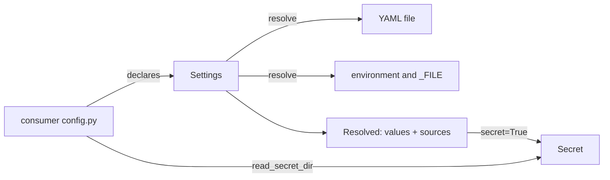

# Architecture Internals

How interpose works inside: for contributors, reviewers and AI assistants. User-facing behaviour belongs on the other pages.

## Overview

Four modules and no global state. A consumer's `config.py` builds one `Settings` at import, which only validates the declarations and binds the prefix. All I/O happens when `resolve()` is called.

## Components

| Module | Responsibility |
|---|---|
| `interpose/__init__.py` | Package version and description |
| `interpose/settings.py` | `Setting`, `Settings`, `Resolved`, `ConfigError`, coercion, the single-value checks |
| `interpose/secret.py` | `Secret`, `MASK`, `read_secret_dir` |
| `interpose/metrics.py` | `Label`, `Counter`, `Gauge`, `Histogram`, `Registry`, `CONTENT_TYPE`: Prometheus text exposition |
| `interpose/pipeline.py` | `Policy`, `Entry`, `Pipeline`, `Run`, `Failure`, `HookFailed`: the middleware loop and the guard around every hook |

## Data flow

`Settings.resolve(path, environ)`:

1. **The file.** `path`, else `environ[<PREFIX>CONFIG]`, else `default_path`. Missing or empty means `{}`. A top level that isn't a mapping, unreadable, not UTF-8 or invalid YAML is a `ConfigError`. A YAML error gives the line and column only, because pyyaml's own message quotes the line, which may hold a secret.
2. **Each setting, in declaration order**, takes its raw value from the first of `<ENV>_FILE` (the file's text, trailing whitespace stripped), `<ENV>`, the YAML value at the dotted key, or the default. A YAML `null`, or a scalar where a mapping is expected, counts as absent. The source is recorded.
3. **Coercion** to the setting's type. Anything else is a `ConfigError` naming the key, the type and the source:

   | Type | Accepts | Refuses (the drifted cases) |
   |---|---|---|
   | bool | a bool; `1/true/yes/on`, `0/false/no/off` in any case, as a string or a YAML 1/0 | `2`, `1.0`, lists |
   | int | an int; a string of ASCII digits with an optional sign | a float (`0.5` was a silent `0`), a bool (`true` was `1`), `"1_000"` |
   | str | a scalar: string, int, float, bool, date | a list or mapping (was its repr), a set, binary |
   | list | a YAML list of scalars, or a comma-separated string; items stripped, empties dropped | a mapping, nested lists, a bare YAML number or bool |

   Strings from the environment and `_FILE` go through the same rules, so `"0.5"` fails `int` everywhere. pyyaml types YAML 1.1 values first: `yes` is already `True`, `1_000` is already `1000`.
4. **`check`**, on every value, the default included. Its `ValueError` becomes `ConfigError("<key>: <reason>")`, with a secret value masked out of the reason. A value it returns replaces the coerced one if it is the setting's kind, else a `ConfigError`; a secret setting's value is never replaced ([0007](https://github.com/metalayerlab/interpose/blob/main/docs/design/0007-check-replacements-and-typed-accessors.md)).
5. **`secret=True`** wraps the value in `Secret`, after the check.

Nothing is cached, and nothing is logged. The first error stops the resolve.

### Metrics

A project builds its metrics at startup, each with `Label` objects that hold the allowed values, and registers them in a `Registry`. Each `inc`/`set`/`add`/`observe` checks its label values against those sets before it touches a series, so a refused value leaves no trace. A gauge's `read` callback is checked when it renders. `Registry.render()` walks the metrics in registration order:

- `# HELP` (with `\` and newline escaped) and `# TYPE`, then each series sorted by its label values;
- label values escape `\`, `"` and newline; integral numbers have no decimal point; `+Inf`, `-Inf`, `NaN`;
- a histogram writes cumulative `_bucket` lines with `le` as Python's `repr` of the bound (`"1.0"`), then `le="+Inf"`, `_sum` and `_count`.

That is byte-for-byte mitm-proxy's output before it moved here (0002), which keeps its dashboards working.

### Pipeline

A project builds a `Pipeline` once (its chain and its `Policy`) and calls `start()` per unit. The `Run` holds what applies, what has failed, what ran (with its context) and whether a before phase stopped. Every hook call goes through one guard:

1. Skip if the entry has failed (observers: unless `observe_failed`) or `skip_inherited` says the hook isn't overridden: neither the middleware's class nor the instance itself defines it ([0004](https://github.com/metalayerlab/interpose/blob/main/docs/design/0004-pipeline-core-decisions.md)). In `each` and `before`, such a hook counts as the base's no-op returning `None`, so `until` is asked as if it had run.
2. Time it into `timings[name]` with `time.perf_counter`, failed calls included.
3. Bound it with `asyncio.timeout` (the entry's timeout, else the policy's; `NO_LIMIT` means none, and with no limit the hook is awaited directly). Only the guard's own limit is a timeout (`expired()`); a `TimeoutError` the hook raises is an ordinary failure. A hook that *returns* after its limit is a timeout too, its result discarded ([0005](https://github.com/metalayerlab/interpose/blob/main/docs/design/0005-hook-cancellation-and-late-results.md)): `late="swallowed"` if the deadline fired (`expired()`), so the hook caught its cancellation; `late="overran"` if it never fired but the loop clock is past `when()`, so the hook ran synchronous code past the deadline. Both use public `asyncio` API, and `asyncio.timeout`'s exit withdraws its cancel request, so nothing is left pending for the caller.
4. Catch `Exception`. `answers` are re-raised (not by observers). Anything else, or a result `valid` refuses (or a `valid` that raises), is a failure: the entry leaves `active`, `on_failure` gets a `Failure`, and `"fail"` raises `HookFailed` from the hook's exception; `"skip"` returns `SKIPPED`.

A timeout cancels the hook at its current `await`, so hooks must be cancel-safe (`try/finally`, `async with`) and must never swallow `CancelledError` or `BaseException`; blocking or CPU-bound work belongs off the event loop, since a timeout can't interrupt synchronous code, and a thread from `run_in_executor` or `asyncio.to_thread` keeps running after its `await` is cancelled.

Every hook is awaited in turn on the caller's task. Nothing is scheduled with `create_task`, which is what carries backpressure from a slow hook back to the reader. Nothing is logged: `on_failure` is where the project logs with its unit ID. `after_pairs()` applies the after-phase policy: what ran, minus what failed, in `after_order`, and nothing after a stop unless `after_local`.

#### Performance

Each phase awaits the guard directly with the hook's arguments as a tuple (one coroutine frame per call, no `partial`), the guard enters `asyncio.timeout` only when a limit applies, and `Run.active` is cached until an entry fails or `entries` changes ([0006](https://github.com/metalayerlab/interpose/blob/main/docs/design/0006-guard-hot-path.md)). `uv run benchmarks/bench-pipeline.py` measures it; run it again with `PYTHONPATH=<other checkout>/src` to compare. Reference numbers (one workstation, Python 3.13, a no-op hook):

| Case | v0.1.4 | v0.1.5 |
|---|---|---|
| bare `await` | 0.09 µs | 0.09 µs |
| `call`, no timeout | 1.5–1.6 µs | 0.7 µs |
| `call`, 5 s timeout | 3.3–3.5 µs | 3.2–3.5 µs |
| `each` over five middleware, no timeout (bare loop 0.5 µs) | 9.1–9.5 µs | 2.9–3.0 µs |
| `each` over five middleware, 5 s timeout | 20.4–20.8 µs | 17.5–18.2 µs |
| `start` + `before` + `after`, five middleware, no timeout | 20.4–20.5 µs | 7.6–8.3 µs |

With a limit, `asyncio.timeout` (a timer scheduled and cancelled per call) is most of the cost. With `skip_inherited`, a hook a middleware leaves alone isn't awaited at all.

## Design decisions

Why things are the way they are is recorded in [docs/design/](https://github.com/metalayerlab/interpose/tree/main/docs/design). Rejected ideas and the reasons are in [TODO.md](https://github.com/metalayerlab/interpose/blob/main/TODO.md) under "Decided against".

- **A library, pinned by GitHub tag, not a template file or PyPI** ([0001](https://github.com/metalayerlab/interpose/blob/main/docs/design/0001-initial-design.md)): fixes travel as version bumps.
- **`Settings` binds the prefix** (0001): a library can't hold a module-level `ENV_PREFIX` for its caller, and `setting.env` keeps working for consumers' CLIs and wiki generators.
- **Strict coercion** (0001): refuse what isn't the declared type, never convert silently.
- **`Secret` isn't a `str`** (0001): it can't reach a log or an f-string as its value by accident.
- **Mechanism only** (0001): rules that span settings, and policies, stay in each project.
- **Labels from declared sets** ([0002](https://github.com/metalayerlab/interpose/blob/main/docs/design/0002-metrics.md)): an undeclared label value is a `ValueError`, so "no unbounded labels" is enforced, not a comment. Transport (HTTP, a virtual file) stays in the project.
- **Policies are required, not defaulted** ([0003](https://github.com/metalayerlab/interpose/blob/main/docs/design/0003-pipeline-core.md)): fail open or closed, after-hook order, after hooks on local answers and observers on failed middleware are each project's, so none inherits another's by omission. Per-middleware `on_error` and timeout cover the middleware whose role differs from the project default. 0003 also reconciles both consumers' "Decided against" lists; [0004](https://github.com/metalayerlab/interpose/blob/main/docs/design/0004-pipeline-core-decisions.md) records Stephen's answers to its decisions and makes `skip_inherited` instance-aware.
