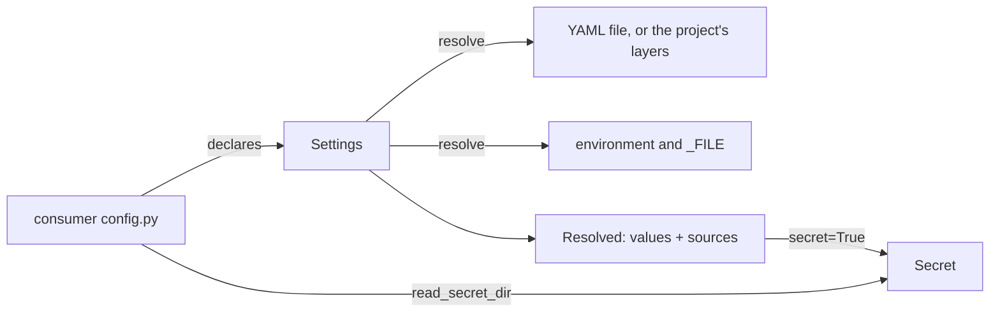

# Architecture Internals

How interpose works inside: for contributors, reviewers and AI assistants. User-facing behaviour belongs on the other pages.

## Overview

Four modules and no global state. A consumer's `config.py` builds one `Settings` at import, which only validates the declarations and binds the prefix. All I/O happens when `resolve()` is called.

## Components

| Module | Responsibility |
|---|---|
| `interpose/__init__.py` | Package version and description |
| `interpose/pipeline.py` | `Policy`, `Entry`, `Pipeline`, `Run`, `Failure`, `HookFailed`: the middleware loop and the guard around every hook |
| `interpose/settings.py` | `Setting`, `Settings`, `Layer`, `Resolved`, `Section`, `ConfigError`, `ConfigWarning`, coercion, sections and secret leaves, the single-value checks |
| `interpose/secret.py` | `Secret`, `MASK`, `read_secret_dir` |
| `interpose/metrics.py` | `Label`, `Counter`, `Gauge`, `Histogram`, `Registry`, `CONTENT_TYPE`: Prometheus text exposition |

## Data flow

### Pipeline

A project builds a `Pipeline` once (its chain and its `Policy`) and calls `start()` per unit. The `Run` holds what applies, what has failed, what ran (with its context) and whether a before phase stopped. Every hook call goes through one guard:

1. Skip if the entry has failed (observers: unless `observe_failed`) or `skip_inherited` says the hook isn't overridden: neither the middleware's class nor the instance itself defines it ([0004](https://github.com/metalayerlab/interpose/blob/main/docs/design/0004-pipeline-core-decisions.md)). That is worked out once per entry when the `Pipeline` is built, so the guard asks a dict and a set ([0008](https://github.com/metalayerlab/interpose/blob/main/docs/design/0008-skip-inherited-resolved-once.md)); a hook assigned after the build isn't seen. In `each` and `before`, such a hook counts as the base's no-op returning `None`, so `until` is asked as if it had run.
2. Time it into `timings[name]` with `time.perf_counter`, failed calls included.
3. Bound it with `asyncio.timeout` (the entry's timeout, else the policy's; `NO_LIMIT` means none, and with no limit the hook is awaited directly). Only the guard's own limit is a timeout (`expired()`); a `TimeoutError` the hook raises is an ordinary failure. A hook that *returns* after its limit is a timeout too, its result discarded ([0005](https://github.com/metalayerlab/interpose/blob/main/docs/design/0005-hook-cancellation-and-late-results.md)): `late="swallowed"` if the deadline fired (`expired()`), so the hook caught its cancellation; `late="overran"` if it never fired but the loop clock is past `when()`, so the hook ran synchronous code past the deadline. Both use public `asyncio` API, and `asyncio.timeout`'s exit withdraws its cancel request, so nothing is left pending for the caller.
4. Catch `Exception`. `answers` are re-raised (not by observers). Anything else, or a result `valid` refuses (or a `valid` that raises), is a failure: the entry leaves `active`, `on_failure` gets a `Failure`, and `"fail"` raises `HookFailed` from the hook's exception; `"skip"` returns `SKIPPED`.

A timeout cancels the hook at its current `await`, so hooks must be cancel-safe (`try/finally`, `async with`) and must never swallow `CancelledError` or `BaseException`; blocking or CPU-bound work belongs off the event loop, since a timeout can't interrupt synchronous code, and a thread from `run_in_executor` or `asyncio.to_thread` keeps running after its `await` is cancelled.

Every hook is awaited in turn on the caller's task. Nothing is scheduled with `create_task`, which is what carries backpressure from a slow hook back to the reader. Nothing is logged: `on_failure` is where the project logs with its unit ID. `after_pairs()` applies the after-phase policy: what ran, minus what failed, in `after_order`, and nothing after a stop unless `after_local`.

#### Performance

Each phase awaits the guard directly with the hook's arguments as a tuple (one coroutine frame per call, no `partial`), the guard enters `asyncio.timeout` only when a limit applies, and `Run.active` is cached until an entry fails or `entries` changes ([0006](https://github.com/metalayerlab/interpose/blob/main/docs/design/0006-guard-hot-path.md)). `uv run benchmarks/bench-pipeline.py` measures it; run it again with `PYTHONPATH=<other checkout>/src` to compare. Reference numbers (one workstation, Python 3.13, a no-op hook):

| Case | v0.1.4 | v0.1.5 |
|---|---|---|
| bare `await` | 0.09 µs | 0.09 µs |
| `call`, no timeout | 1.5–1.6 µs | 0.7 µs |
| `call`, 5 s timeout | 3.3–3.5 µs | 3.2–3.5 µs |
| `each` over five middleware, no timeout (bare loop 0.5 µs) | 9.1–9.5 µs | 2.9–3.0 µs |
| `each` over five middleware, 5 s timeout | 20.4–20.8 µs | 17.5–18.2 µs |
| `start` + `before` + `after`, five middleware, no timeout | 20.4–20.5 µs | 7.6–8.3 µs |

With a limit, `asyncio.timeout` (a timer scheduled and cancelled per call) is most of the cost. With `skip_inherited`, a hook a middleware leaves alone isn't awaited at all, and since [0008](https://github.com/metalayerlab/interpose/blob/main/docs/design/0008-skip-inherited-resolved-once.md) the check costs less than the guarded call it saves. A unit (`start` + `before` + `after`) through sluice's two five-middleware chains, no timeout:

| Chain | every hook awaited | `skip_inherited`, v0.2.0 (per call) | `skip_inherited`, resolved once (0008) |
|---|---|---|---|
| typical (2 of 10 hooks inherited) | 8.0–8.5 µs | 9.6–10.3 µs | 7.8–8.2 µs |
| five `pre`-only gates (5 of 10 inherited) | 7.9–8.3 µs | 8.9 µs | 6.7 µs |

### Settings

`Settings.resolve(path, environ, *, layers)`:

1. **The layers.** Without `layers`, the one layer is the file (`read_file`): `path`, else `environ[<PREFIX>CONFIG]`, else `default_path`, with source `"file"` and `where` the path. Missing or empty means `{}`. A top level that isn't a mapping, unreadable, not UTF-8 or invalid YAML is a `ConfigError`. A YAML error gives the line and column only, because pyyaml's own message quotes the line, which may hold a secret. With `layers`, no file is read: the project's layers take its place, first one first (a control-plane payload, then the local file, say: [0009](https://github.com/metalayerlab/interpose/blob/main/docs/design/0009-settings-extensions.md)).
2. **Each setting, in declaration order**, takes its raw value from the first of `<ENV>_FILE` (the file's text, trailing whitespace stripped), `<ENV>`, each layer's value at the dotted key in order, or the default. A YAML `null`, or a scalar where a mapping is expected, counts as absent, so the next layer is tried. A setting with `aliases` is looked up under its key and every alias together at each of those levels: the `_FILE` variables, then the variables, then each layer. The first level where any is set decides, so an alias's variable beats the key in the file. When several are set there, each is coerced and they must be equal, else `ConfigError("<key>: set as both '<key>' and its old name '<alias>' (from <where>), to different values")`, never with the values (for variables, the names are the variables' and `<where>` is `the environment`); the key's value, else the first alias's, is the one read and checked ([0009](https://github.com/metalayerlab/interpose/blob/main/docs/design/0009-settings-extensions.md)). The source is recorded: the variable (an alias's, if that was read), the layer's `source` (`"file"` for the file), or `"default"`. For a value from a layer, so is where it came from: `origins[key]` if the layer has it, else its `where`. A layer's `data` is only read.
3. **Expansion**, only for a value from a layer with `expand=True` (the file's, when the project passes `Settings(expand=True)`) [0009](https://github.com/metalayerlab/interpose/blob/main/docs/design/0009-settings-extensions.md). It comes once the level is chosen, so an expanded empty string doesn't fall through to the next layer, and before coercion and the alias comparison, so `"${PORT:-5000}"` coerces to 5000 and a key and its alias are compared expanded and typed. Every string in the raw value is passed through one regular expression: `$${`, `${NAME}`, `${NAME:-default}` (default up to the first `}`), or any other `${`, which is a `ConfigError` naming the key and its position, never the text. Mapping keys and non-strings are untouched. A variable is looked up in `resolve()`'s `environ`; unset with no default is a `ConfigError` naming the key, the variable and where, or the empty string with `expand_unset="empty"`. No message holds a variable's value. Variables, `_FILE` contents and defaults are never expanded, and nothing an unknown key holds is looked at. The value as written is kept for errors: a coercion error shows it in place of the expanded one, and a check's reason has the expanded value replaced by it (item by item for a list; an item a variable's comma split off is masked), so a non-secret value embedding a secret variable shows `${PASS}`, not the password.
4. **Coercion** to the setting's type. Anything else is a `ConfigError` naming the key, the type and where the value came from (the variable, `default`, or the layer's `where`, which for the file is its path):

   | Type | Accepts | Refuses (the drifted cases) |
   |---|---|---|
   | bool | a bool; `1/true/yes/on`, `0/false/no/off` in any case, as a string or a YAML 1/0 | `2`, `1.0`, lists |
   | int | an int; a string of ASCII digits with an optional sign | a float (`0.5` was a silent `0`), a bool (`true` was `1`), `"1_000"` |
   | str | a scalar: string, int, float, bool, date | a list or mapping (was its repr), a set, binary |
   | list | a YAML list of scalars, or a comma-separated string; items stripped, empties dropped | a mapping, nested lists, a bare YAML number or bool |

   Strings from the environment and `_FILE` go through the same rules, so `"0.5"` fails `int` everywhere. pyyaml types YAML 1.1 values first: `yes` is already `True`, `1_000` is already `1000`.
5. **`check`**, on every value, the default included. Its `ValueError` becomes `ConfigError("<key>: <reason>")`, then `(from <where>)` for a value from a layer, with a secret value masked out of the reason. A value it returns replaces the coerced one if it is the setting's kind, else a `ConfigError`; a secret setting's value is never replaced ([0007](https://github.com/metalayerlab/interpose/blob/main/docs/design/0007-check-replacements-and-typed-accessors.md)).
6. **`secret=True`** wraps the value in `Secret`, after the check.

   **A section** (`is_section=True`) takes the same order and alias rule with three differences, and a shape check and secret leaves in place of coercion ([0009](https://github.com/metalayerlab/interpose/blob/main/docs/design/0009-settings-extensions.md)). Its `_FILE` names a YAML file, parsed as the config file is (errors name the variable and path, never the text; empty is an empty section), and it is local configuration: its value expands with the project's `expand` and may hold secret leaves. Its plain variable (or an alias's) is never read: if set, even beside a `_FILE`, it is a `ConfigError` saying to use `_FILE`. Its default is an empty `Section`, or `()` for a list section. The chosen value is expanded (when its layer expands, keys never), then frozen: it must be a mapping (a list of mappings for a list section), every key at every depth a string (else a `ConfigError` naming the path, the key by its YAML text: `middleware.config.true`), and every value a mapping, list or YAML scalar (else a `ConfigError` naming the path and the type). Mappings become `Section`s and lists tuples. A mapping that is exactly `{secret_file: <path>}` is a secret leaf: if the value came from a layer without `secret_files` (only `read_file()` and a section's `_FILE` set it), it is a `ConfigError` naming the section path and the layer, before anything is opened (decision E); otherwise the file is read into a `Secret`, trailing whitespace stripped, every resolve, and an unreadable file is a `ConfigError` naming the path and the file, never its contents. A section or list item that is itself a leaf is an error. A key and an alias set at one level are both frozen and compared with `Section` equality, which compares types as well as values. The check gets the frozen value; its reason has expanded strings replaced by the text as written and every secret leaf's value masked, and a replacement must be a `Section` (a tuple of them for a list section). `Resolved` records each section's kind, so an empty list section isn't taken for an empty list setting.
7. **Unknown keys and variables** ([0009](https://github.com/metalayerlab/interpose/blob/main/docs/design/0009-settings-extensions.md)), once every setting has resolved. Each layer's tree is walked in document order: a dotted path is known if it is a setting's key or alias or a parent of one, and nothing below a setting's key or alias, or below a scalar, is looked at. An alias that is set (not `null`) gives an `alias` warning there, in document order, whether or not its value was the one read. Each unknown path gives one `ConfigWarning`, at its first unknown level; a non-string key (`on:` loads as `True`) is never known and is named by its YAML text, and neither is a key with a dot in it (`listen.port:` at the top level), which resolution never reads. Then each environment variable that starts with the prefix, by name, unless a setting reads it (its variable or `_FILE`, or an alias's), it is `<PREFIX>CONFIG` or it is in `extra_env`; with an empty prefix no variable is reported unknown. An alias's variable that is set gives an `alias` warning in that order, with or without a prefix. Only names are read, never values. The suggestion is `difflib.get_close_matches` with cutoff 0.75 over current names, never an alias: for a key, the keys and parents at the same depth (so `listne` suggests `listen`, and `listen.1` never its own parent); for a variable, the variables settings read. The known names are sets built once in `Settings`, with aliases, their parents and their variables in them but not in the sets suggestions come from. A section's key and aliases are leaves, so nothing below one is checked: its content is the project's. Typed list items extend the sets in a later step.

Nothing is cached, and nothing is logged. The first error stops the resolve; warnings never do.

### Metrics

A project builds its metrics at startup, each with `Label` objects that hold the allowed values, and registers them in a `Registry`. Each `inc`/`set`/`add`/`observe` checks its label values against those sets before it touches a series, so a refused value leaves no trace. A gauge's `read` callback is checked when it renders. `Registry.render()` walks the metrics in registration order:

- `# HELP` (with `\` and newline escaped) and `# TYPE`, then each series sorted by its label values;
- label values escape `\`, `"` and newline; integral numbers have no decimal point; `+Inf`, `-Inf`, `NaN`;
- a histogram writes cumulative `_bucket` lines with `le` as Python's `repr` of the bound (`"1.0"`), then `le="+Inf"`, `_sum` and `_count`.

That is byte-for-byte mitm-proxy's output before it moved here (0002), which keeps its dashboards working.

## Design decisions

Why things are the way they are is recorded in [docs/design/](https://github.com/metalayerlab/interpose/tree/main/docs/design). Rejected ideas and the reasons are in [TODO.md](https://github.com/metalayerlab/interpose/blob/main/TODO.md) under "Decided against".

- **A library, pinned by GitHub tag, not a template file or PyPI** ([0001](https://github.com/metalayerlab/interpose/blob/main/docs/design/0001-initial-design.md)): fixes travel as version bumps.
- **Policies are required, not defaulted** ([0003](https://github.com/metalayerlab/interpose/blob/main/docs/design/0003-pipeline-core.md)): fail open or closed, after-hook order, after hooks on local answers and observers on failed middleware are each project's, so none inherits another's by omission. Per-middleware `on_error` and timeout cover the middleware whose role differs from the project default. 0003 also reconciles both consumers' "Decided against" lists; [0004](https://github.com/metalayerlab/interpose/blob/main/docs/design/0004-pipeline-core-decisions.md) records Stephen's answers to its decisions and makes `skip_inherited` instance-aware.
- **`Settings` binds the prefix** (0001): a library can't hold a module-level `ENV_PREFIX` for its caller, and `setting.env` keeps working for consumers' CLIs and wiki generators.
- **Strict coercion** (0001): refuse what isn't the declared type, never convert silently.
- **`Secret` isn't a `str`** (0001): it can't reach a log or an f-string as its value by accident.
- **Mechanism only** (0001): rules that span settings, and policies, stay in each project.
- **Labels from declared sets** ([0002](https://github.com/metalayerlab/interpose/blob/main/docs/design/0002-metrics.md)): an undeclared label value is a `ValueError`, so "no unbounded labels" is enforced, not a comment. Transport (HTTP, a virtual file) stays in the project.
