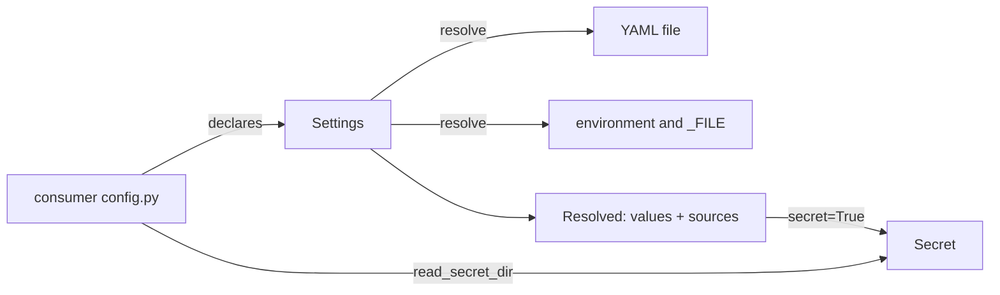

# Architecture Internals

How interpose works inside: for contributors, reviewers and AI assistants. User-facing behaviour belongs on the other pages.

## Overview

Three modules and no global state. A consumer's `config.py` builds one `Settings` at import, which only validates the declarations and binds the prefix. All I/O happens when `resolve()` is called.

## Components

| Module | Responsibility |
|---|---|
| `interpose/__init__.py` | Package version and description |
| `interpose/settings.py` | `Setting`, `Settings`, `Resolved`, `ConfigError`, coercion, the single-value checks |
| `interpose/secret.py` | `Secret`, `MASK`, `read_secret_dir` |
| `interpose/metrics.py` | `Label`, `Counter`, `Gauge`, `Histogram`, `Registry`, `CONTENT_TYPE`: Prometheus text exposition |

## Data flow

`Settings.resolve(path, environ)`:

1. **The file.** `path`, else `environ[<PREFIX>CONFIG]`, else `default_path`. Missing or empty means `{}`. A top level that isn't a mapping, unreadable, not UTF-8 or invalid YAML is a `ConfigError`. A YAML error gives the line and column only, because pyyaml's own message quotes the line, which may hold a secret.
2. **Each setting, in declaration order**, takes its raw value from the first of `<ENV>_FILE` (the file's text, trailing whitespace stripped), `<ENV>`, the YAML value at the dotted key, or the default. A YAML `null`, or a scalar where a mapping is expected, counts as absent. The source is recorded.
3. **Coercion** to the setting's type. Anything else is a `ConfigError` naming the key, the type and the source:

   | Type | Accepts | Refuses (the drifted cases) |
   |---|---|---|
   | bool | a bool; `1/true/yes/on`, `0/false/no/off` in any case, as a string or a YAML 1/0 | `2`, `1.0`, lists |
   | int | an int; a string of ASCII digits with an optional sign | a float (`0.5` was a silent `0`), a bool (`true` was `1`), `"1_000"` |
   | str | a scalar: string, int, float, bool, date | a list or mapping (was its repr), a set, binary |
   | list | a YAML list of scalars, or a comma-separated string; items stripped, empties dropped | a mapping, nested lists, a bare YAML number or bool |

   Strings from the environment and `_FILE` go through the same rules, so `"0.5"` fails `int` everywhere. pyyaml types YAML 1.1 values first: `yes` is already `True`, `1_000` is already `1000`.
4. **`check`**, on every value, the default included. Its `ValueError` becomes `ConfigError("<key>: <reason>")`, with a secret value masked out of the reason.
5. **`secret=True`** wraps the value in `Secret`, after the check.

Nothing is cached, and nothing is logged. The first error stops the resolve.

### Metrics

A project builds its metrics at startup, each with `Label` objects that hold the allowed values, and registers them in a `Registry`. Each `inc`/`set`/`add`/`observe` checks its label values against those sets before it touches a series, so a refused value leaves no trace. A gauge's `read` callback is checked when it renders. `Registry.render()` walks the metrics in registration order:

- `# HELP` (with `\` and newline escaped) and `# TYPE`, then each series sorted by its label values;
- label values escape `\`, `"` and newline; integral numbers have no decimal point; `+Inf`, `-Inf`, `NaN`;
- a histogram writes cumulative `_bucket` lines with `le` as Python's `repr` of the bound (`"1.0"`), then `le="+Inf"`, `_sum` and `_count`.

That is byte-for-byte mitm-proxy's output before it moved here (0002), which keeps its dashboards working.

## Design decisions

Why things are the way they are is recorded in [docs/design/](https://github.com/metalayerlab/interpose/tree/main/docs/design). Rejected ideas and the reasons are in [TODO.md](https://github.com/metalayerlab/interpose/blob/main/TODO.md) under "Decided against".

- **A library, pinned by GitHub tag, not a template file or PyPI** ([0001](https://github.com/metalayerlab/interpose/blob/main/docs/design/0001-initial-design.md)): fixes travel as version bumps.
- **`Settings` binds the prefix** (0001): a library can't hold a module-level `ENV_PREFIX` for its caller, and `setting.env` keeps working for consumers' CLIs and wiki generators.
- **Strict coercion** (0001): refuse what isn't the declared type, never convert silently.
- **`Secret` isn't a `str`** (0001): it can't reach a log or an f-string as its value by accident.
- **Mechanism only** (0001): rules that span settings, and policies, stay in each project.
- **Labels from declared sets** ([0002](https://github.com/metalayerlab/interpose/blob/main/docs/design/0002-metrics.md)): an undeclared label value is a `ValueError`, so "no unbounded labels" is enforced, not a comment. Transport (HTTP, a virtual file) stays in the project.
